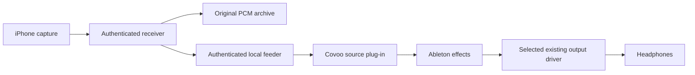

# Ableton effects ingress choices

Status: feasibility proposal for workflow review. No Covoo plug-in or driver has
been implemented, installed or selected by this change. The user was asked whether
a plug-in workflow is acceptable; implementation does not assume an answer.

## Problem and observed state

The latest complete active Live log state is November 3, 2026 at 04:06:08,
48 kHz/256 samples, FL Studio ASIO: 46 ms input and 60 ms output, 106 ms overall.
Live was closed during the November 4 inspection. This is historical driver
reporting, not current preferences or a calibrated microphone-to-headphone result.
Covoo's dry monitor bypasses Live effects. It cannot meet the requested effects
workflow by itself.

## Choices

| Route | What it can replace/bypass | What remains | Prerequisites |
| --- | --- | --- | --- |
| Existing cable and FL Studio ASIO | Smaller supported buffers may reduce part of this route | Cable, reported input/output delay, effects and upstream phone/Covoo buffering | User-controlled driver panel and physical comparison |
| Native WaveRT microphone | External virtual-cable stage; system microphone enumeration | Ableton driver route, output buffering and effects; no automatic ASIO compatibility | Matching SDK/WDK/VS, reviewed feeder identity, signing and isolated installation target |
| Covoo receiver plug-in in Live | Cable and hardware-input stage; phone PCM enters the device chain directly | Local transfer/queue, Live processing and its selected output driver | New plug-in workflow and host validation; candidate existing output driver must be measured |
| Covoo ASIO implementation | Could own DAW input/output boundary | Playback compatibility, clocks, host behavior, licensing and validation | Outside present authorization; not implemented or selected |

Recommendation for the effects-latency objective: investigate a receiver plug-in
if that workflow is acceptable, while retaining native microphone research as
the system-wide path. A native capture endpoint alone does not address the
recorded 60 ms output stage. A plug-in with the same FL Studio output route still
has that output stage; bypassing an input stage is not a promised 46 ms reduction
or near-immediate total. Test a suitable existing playback driver manually later.
Registered Realtek/Focusrite/ZOOM drivers are candidates only: registration proves
neither hardware availability, supported buffers nor low measured latency.

## Concrete plug-in candidate

Use a Windows x64 VST 3 instrument/source with mono phone PCM duplicated to its
stereo audio bus. It generates live audio without MIDI notes. In Live, load it
on a MIDI/instrument track, add audio effects after it, and record that track's
audio into an audio track. Recording MIDI clips on the source track alone does
not record microphone waveforms. Idle/armed processing and correct audio routing
must pass a real Live check before this workflow is accepted.

The path would be:

Retain the current phone pairing/TLS/UDP protocol and receiver-owned archive.
Keep a bounded authenticated local bridge separate from the phone transport and
from the draft kernel CVE1 contract. A proposed named-pipe bridge must restrict
the current user, reject remote clients and use independent per-receiver/consumer
credentials. Names or source generations are not authorization. Do not save phone
tokens or bridge secrets in Live projects or plug-in state. Settle pipe API/ACL
review and owner/forget/restart lifecycle before implementing the IPC.

The plug-in's background worker handles IPC, validation and a bounded SPSC queue.
The processor consumes only preallocated PCM and atomics: no network, pipe/file
calls, locks, logging, allocation or waiting in process or setProcessing. Silence
on starvation is counted. Host block-size/rate changes, stop, suspend, disconnect,
multiple instances and offline rendering need explicit behavior and tests; never
replay previous-session voice or wait for a phone during an offline bounce.

Follow the DAW clock. The receiver can adapt the existing preallocated renderer
on a feeder worker using host-rate, consumption and queue feedback from the local
bridge. Do not treat phone timestamps as shared clocks or reuse the render-endpoint
adapter as a verified DAW feeder. Resampling/clock behavior needs its own synthetic
tests and physical drift acceptance. No Rust FFI or new unsafe Rust is assumed.

## SDK and workspace build plan

Steinberg publishes VST 3 SDK under MIT. A concrete candidate is upstream tag
v3.8.1_build_84, commit 3cdf9ca5d1f5b1b21e0a86832aa4abe55607bd96, observed with
git ls-remote on November 4. Pin all submodules and retain their license notices
if imported. This records upstream licensing; it is not a completed distribution
or trademark review. VST and ASIO are distinct interfaces; no ASIO SDK is needed
to build this plug-in candidate.

Build only in workspace build/.tools directories. Explicitly disable SDK plug-in
symlink/installation generation with SMTG_CREATE_PLUGIN_LINK=OFF. Disable VSTGUI
and unrelated examples/audio-host backends; build only the needed SDK, validator
and Covoo target. Do not enable ASIO code or copy anything into Live's plug-in
folders. First validate setup/teardown, silence, synthetic PCM, bounded queue,
starvation, variable blocks/rates and callback constraints in an offline test
host. Then prepare an uninstalled bundle and a separate user-controlled Live
test guide. Build success is not host, microphone or latency acceptance.

This is an implementation choice prepared for review, not a functioning Covoo
plug-in. The pinned SDK and four required submodules were downloaded into ignored
.tools/ for a stock ADelay sample build in ignored build/. Its Release x64 build
and 57 validator tests passed with plug-in linking, GUI support and audio-host
examples disabled. Nothing was installed or loaded into Live. Reproduction and
limits are in [the toolchain check](../testing/vst3-toolchain.md). SDK sources and
generated binaries are not included in version control or the Covoo package.

## Sources checked November 4, 2026

- [Ableton driver guidance](https://help.ableton.com/hc/en-us/articles/360003149240-Using-an-ASIO-audio-driver-on-Windows).
- [Ableton latency](https://help.ableton.com/hc/en-us/articles/360010545559-How-Latency-Works).
- [Live internal routing](https://www.ableton.com/en/manual/routing-and-i-o/).
- [Steinberg VST SDK and licensing](https://www.steinberg.net/developers/vstsdk/).
- [VST process thread constraints](https://steinbergmedia.github.io/vst3_dev_portal/pages/FAQ/Processing.html).
- [SDK build options](https://steinbergmedia.github.io/vst3_dev_portal/pages/Tutorials/Using%2Bcmake%2Bfor%2Bbuilding%2Bplug-ins.html).
- [Microsoft supported kit matrix](https://learn.microsoft.com/en-us/windows-hardware/drivers/other-wdk-downloads).
